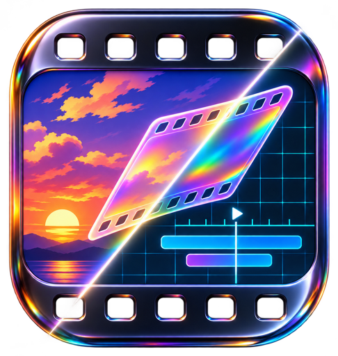

<p align="center">
  
</p>

<h1 align="center">
  
</h1>

<p align="center">
  <b>Agent skills for product films that look made by a studio.</b><br>
  Your real product recorded at a smooth 60 fps and cut like a trailer, with its own music.<br>
  Opening on a title made in code that match-cuts into your product, or on generated shots if you want a story.
</p>

<p align="center">
  <a href="LICENSE"></a>
  <a href="#install"></a>
  <a href="#install"></a>
  <a href="skills/clip-prompts/references/models"></a>
</p>

<p align="center">
  <a href="https://github.com/abundantbeing/matchcut/releases/download/v0.1.0/demo.mp4"></a><br>
  <sub>Made with matchcut from the demo app in <a href="examples/demo">examples/demo</a>: a title intro whose dots match-cut into the app's live globe, then real footage of a launch and its first photo, its own song and a sound on every click, key, lock and liftoff. Click for the MP4 with sound.</sub>
</p>

---

Ask a coding agent for a product video and you usually get one of two things: a screen recording with zooms, or
motion graphics that look like a slide deck. matchcut gives your agent the way a small studio works instead.

- **The real product, filmed properly.** A headless recorder slows the page's clocks while it records, so every
  frame of every animation lands: 60 fps footage at twice the resolution, the cursor redrawn crisp, demo data that
  is never your real account.
- **A virtual camera.** The edit pushes into what changes, holds, lands, and hides every cut in light, and every cut
  lands on the action, never on a camera still travelling toward it (`npm run check` catches that). One timeline
  file drives the picture, the captions and the music.
- **A story, if you want one.** Stills from any image model with a cast that stays the same shot after shot, clips
  from any video model with prompts that carry the whole story, and the match cut: an object from the story lands
  flat to camera and the next frame is the same object alive in your app.
- **Its own music.** An original score written in code to the film's timeline, nothing to sign up for. Or, if you
  have a music generator (ElevenLabs Music, Suno, Udio, Stable Audio and others), a prompt written from your film's
  own timeline and mood, then the cut fitted to the song's beats. Effects on every click and cut, included (a public-domain kit,
  sounds made in code, or prompts for any sound-effect tool), a measured mix, and a trailer voiceover if you want one.

## Install

**Any agent, with the skills CLI:**

```bash
npx skills add abundantbeing/matchcut --skill '*' -g
```

**Claude Code plugin:**

```
/plugin marketplace add abundantbeing/matchcut
/plugin install matchcut@matchcut
```

**Clone and link** (a `git pull` updates every agent at once):

```bash
git clone https://github.com/abundantbeing/matchcut.git
cd matchcut
./install.sh            # macOS and Linux
./install.ps1           # Windows PowerShell
node scripts/doctor.mjs # says what is missing and what each piece is for
```

## Use it

Brief your agent like a director:

> Make a 40 second launch film for the app in this repo. Record the real UI, push into the moment the export
> finishes, captions in our brand font, its own music, end on the install command.

> Make a 60 second launch film: a photoreal cold open of a city at night that ends on one lit window, then match-cut into
> the same window on our live map. Write me the image prompts and the clip prompts; I'll generate them in ChatGPT and Grok.

> Turn my finished site into a 20 second reel for X, with a vertical cut.

## The skills

| Skill | What it does |
|---|---|
| [`matchcut`](skills/matchcut/SKILL.md) | Start here. Picks the film (product reel, matchcut film, story short), writes the beats, runs the parts in order, delivers the master, a phone preview, social cuts and a letterbox spec |
| [`keyframes`](skills/keyframes/SKILL.md) | Image prompts for film stills: style blocks that read as a real medium, a cast line-up first, composition rules, the hero object, three-frame moves for video models. Notes for GPT Image, Midjourney, Flux, Gemini and Seedream |
| [`clip-prompts`](skills/clip-prompts/SKILL.md) | Video prompts that carry the whole story, first and last frames, lengths, and a table of fixes for extra limbs, duplicate characters, morphs and warped text. Guides for MiniMax, Grok, Seedance, Veo, Kling, Wan, Runway, Luma and LTX |
| [`ui-reel`](skills/ui-reel/SKILL.md) | The recorder (slow-motion capture, 60 fps, redrawn cursor, phone takes, storyboards, rehearsal runs) and a Remotion template with a title intro made in code, the virtual camera, captions, cut blooms, a phone frame, an end card and a timeline check |
| [`score`](skills/score/SKILL.md) | An original soundtrack written in code, or a song prompt for any music generator written from the film's timeline and mood plus a fitter that puts the cuts on its beats; effects on every click and cut, included or prompted; a measured mix, a voiceover |

## Why films go wrong, and what catches it

| What you see | Why | Caught by |
|---|---|---|
| Choppy screen recording, animations skipped | The capture cannot keep up with the page | The slow-motion recorder (`ui-reel`) |
| Soft, blurry zooms | Recording at screen resolution | Device scale 2 footage (`ui-reel`) |
| A floating, drifting camera | Keyframes without a job | One push per shot, eased, zoom in log space (`ui-reel`) |
| Cuts that jolt | Hard cuts between unrelated frames | Blur and bloom over every cut, the match cut (`ui-reel`) |
| Characters change between shots | Each image prompt starts from scratch | One master prompt, a line-up first (`keyframes`) |
| Generic AI-illustration look | No medium named | Style blocks with named works and rules (`keyframes`) |
| Extra arms, duplicate people, melting bodies | Video models inventing what the still never showed | Single-image clips, LOCKED lines, cuts on motion (`clip-prompts`) |
| Stock music that fights the cut | A track written for something else | A score written to the timeline, or a song prompted from it with the cuts moved onto its beats (`score`) |
| A transition that leads to nothing | Cutting wide, then panning to the subject | Cut into the action; `check-tl.mjs` fails the edit (`ui-reel`) |

## What it needs

| For | Needs |
|---|---|
| Prompting only (`keyframes`, `clip-prompts`) | Nothing. Your image and video models of choice |
| Recording (`ui-reel`) | Node 20+, Chrome for Testing, Python 3.9+ with Pillow, ffmpeg |
| The film | Remotion 4 (`npm install` in `templates/reel`) |
| Music | Python with numpy, scipy and soundfile (and ffmpeg to mix in a produced song) |

## Examples

<table>
  <tr>
    <td width="50%" valign="top">
      <a href="https://github.com/abundantbeing/matchcut/releases/download/v0.1.0/trophy-room-reel.mp4"></a>
      <br><b>Hermes Trophy Room</b>: the real-product half of a hackathon film. A holographic trophy card tilts and flips in the live plugin, then the gallery, a live unlock, sharing and a tier ladder on the beat. 56 s, sound.
    </td>
    <td width="50%" valign="top">
      <a href="https://github.com/abundantbeing/matchcut/releases/download/v0.1.0/demo.mp4"></a>
      <br><b>Orbit</b> (<a href="examples/demo">examples/demo</a>): mission control for a satellite fleet. A live Earth, a launch with an ignition lock on the pad, and the first photo coming down line by line. A title intro made in code, three recorded takes, a produced song mixed by <code>score.json</code> and 40 sound cues placed by <code>cues.py</code>. 36 s, sound.
    </td>
  </tr>
</table>

Click a preview for the full film with sound; the MP4s are attached to the [v0.1.0 release](https://github.com/abundantbeing/matchcut/releases/tag/v0.1.0).

## Licence

MIT licence, see [LICENSE](LICENSE).
